# レシピ帳 (Recipe Note)

Android向けのレシピ管理アプリです。

レシピの登録・編集・検索に加え、写真の保存やお気に入り管理、カレンダーへの食事記録ができます。

Google Play: [レシピ帳 - Google Play](https://play.google.com/store/apps/details?id=com.kinomaru.recipenote)

## 使用技術

- Kotlin
- Jetpack Compose
- Material3
- Navigation Compose
- Room
- Kotlin Coroutines
- Flow / StateFlow
- Hilt
- Coil
- MVVM Architecture
- JUnit
- GitHub Actions

## スクリーンショット

<table>
<tr>
<td align="center"><b>ホーム</b></td>
<td align="center"><b>追加</b></td>
<td align="center"><b>一覧</b></td>
</tr>

<tr>
<td>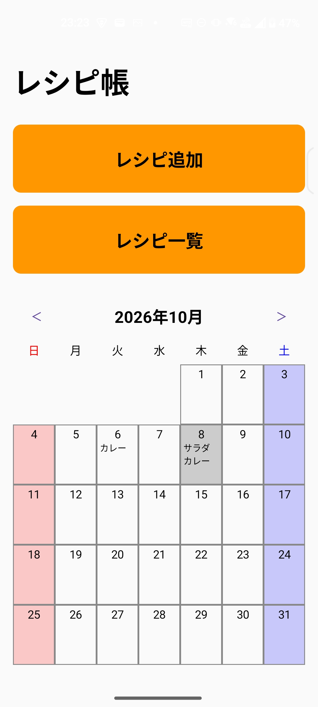</td>
<td>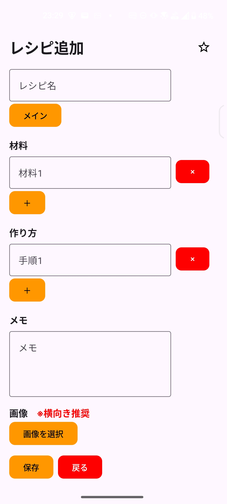</td>
<td>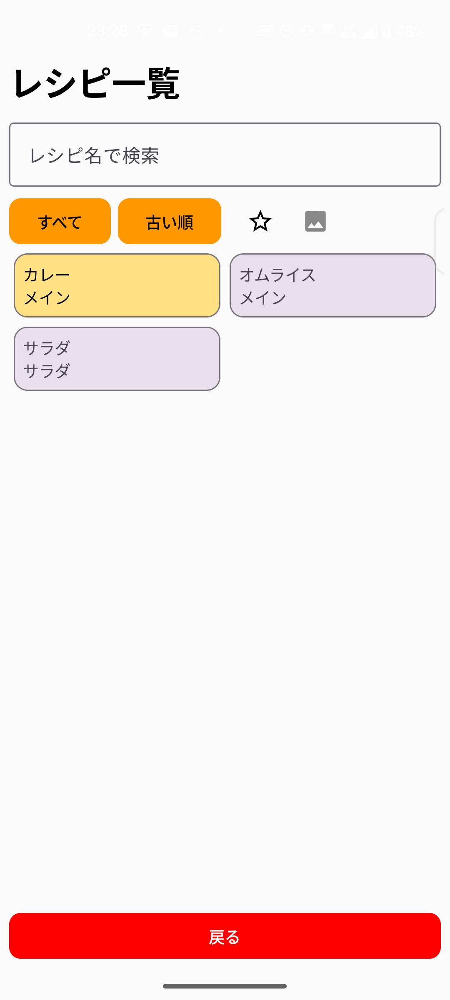</td>
</tr>

<tr>
<td align="center"><b>複数選択</b></td>
<td align="center"><b>画像表示</b></td>
<td align="center"><b>複数選択（画像表示）</b></td>
</tr>

<tr>
<td>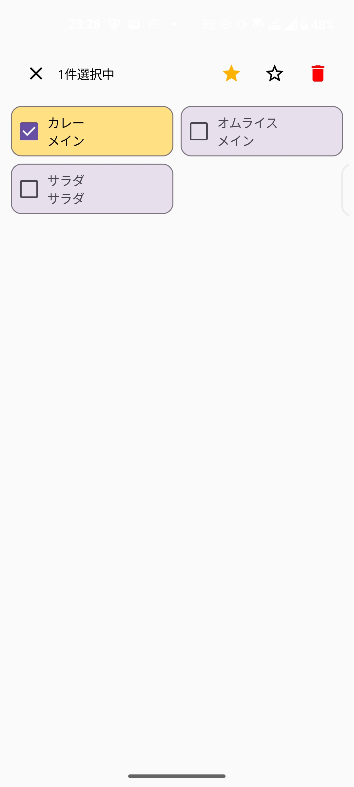</td>
<td>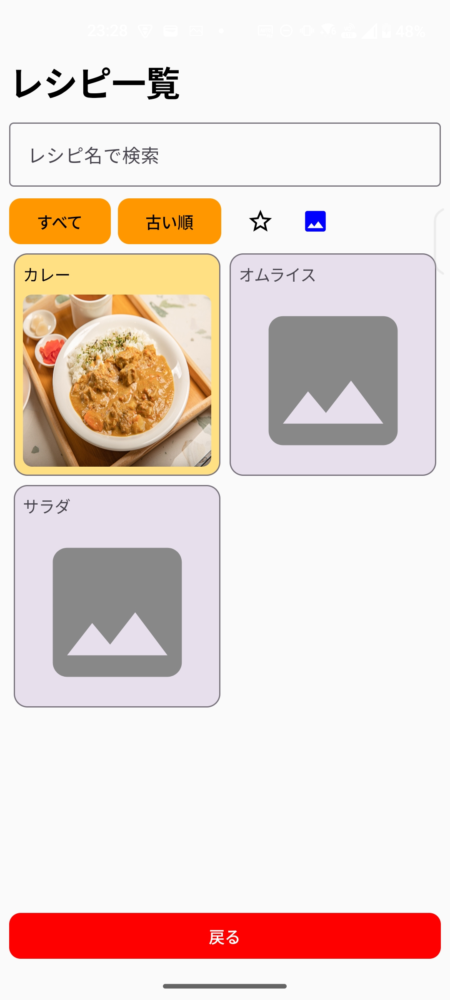</td>
<td>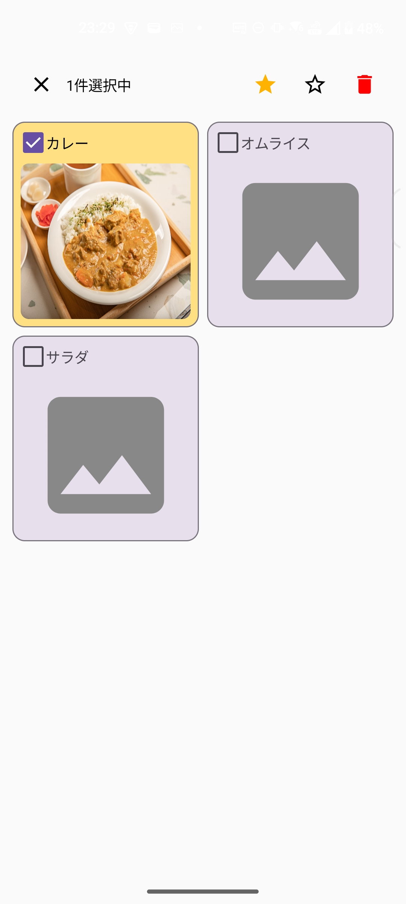</td>
</tr>

<tr>
<td align="center"><b>詳細</b></td>
<td align="center"><b>編集</b></td>
<td align="center"><b>食事記録カレンダー</b></td>
</tr>

<tr>
<td>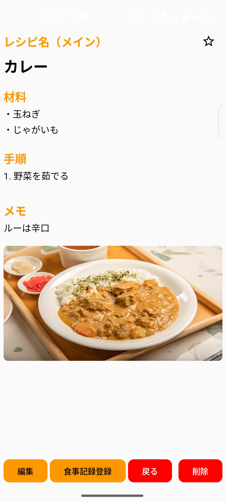</td>
<td>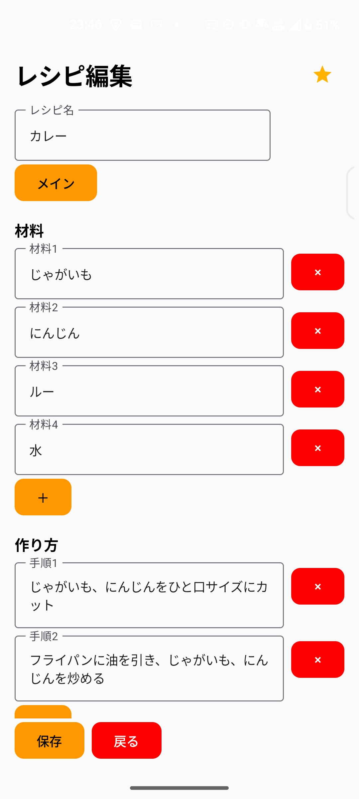</td>
<td>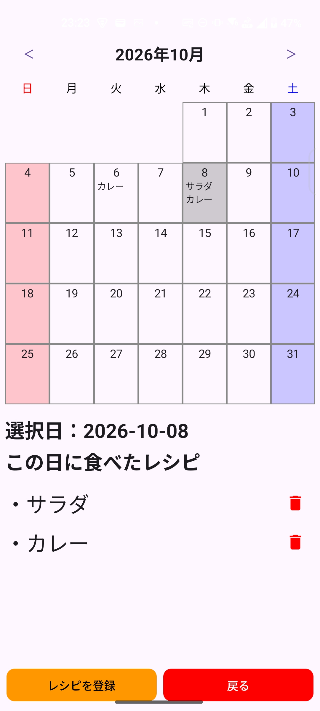</td>
</tr>
</table>

## 主な機能

### レシピ管理
- レシピの登録・編集・削除
- お気に入り登録
- 複数選択による一括お気に入り・お気に入り解除
- 複数選択による一括削除

### 材料・作り方
- 材料を複数登録
- 作り方を複数登録
- 入力欄の動的な追加・削除

### 画像
- ギャラリーから画像を選択
- カメラで撮影した画像を登録
- 画像の回転・削除
- レシピ一覧で画像の表示・非表示を切り替え

### 検索・整理
- キーワード検索
- ジャンルによる分類・絞り込み
- 並び替え
- お気に入りによる絞り込み

### 食事記録カレンダー
- カレンダーから日付を選択
- レシピを食事記録として登録
- レシピ詳細画面から日付を指定して食事記録を登録
- 日付ごとの食事記録を表示
- 登録した食事記録を削除

## 工夫した点

### 保守性・再利用性
- MVVMアーキテクチャを採用し、UI・状態管理・データアクセスの責務を分離
- Repositoryをインターフェースと実装に分離し、テストしやすい構成に設計
- Hiltによる依存性注入を導入
- Room + Flowを利用し、データ変更をリアクティブにUIへ反映
- RecipeFormを追加画面・編集画面で共通化
- CommonDialog、RecipeButton、GenreDropDownなどのUIコンポーネントを共通化

### UI設計
- Jetpack Composeによる宣言的UIを採用
- Material3に対応
- ComposeとStateFlowを組み合わせた状態管理
- 未保存の状態で画面を戻る場合に確認ダイアログを表示
- 複数選択モードや画像表示切り替えなど、用途に応じてUIを切り替え

### データ管理
- Roomを使用してレシピと食事記録を端末内に保存
- RecipeとMealRecordを外部キーで関連付け
- Room Migrationを実装し、既存データを保持したままデータベースを更新
- ギャラリー画像のURI読み取り権限を保持し、アプリ再起動後も画像を表示

## テスト・CI

ViewModel、DAO、Room Migrationを対象に自動テストを実装しています。

### Unit Test
- AddRecipeViewModelTest
- RecipeViewModelTest
- CalendarViewModelTest

### Instrumented Test
- RecipeDaoTest
- MealRecordDaoTest
- MigrationTest

GitHub Actionsを導入し、`master`ブランチへのpushおよびPull Request時にUnit Testを自動実行しています。

## アーキテクチャ・設計

### MVVM構成

MVVMアーキテクチャを採用し、UI・状態管理・データアクセスの責務を分離しています。

- Presentation Layer：Jetpack ComposeによるUI表示
- ViewModel Layer：UI状態管理・入力チェック
- Repository Layer：データアクセス処理の仲介
- Data Layer：Roomによるローカルデータ管理
- Hilt：ViewModel・Repository・Databaseなどの依存関係を管理

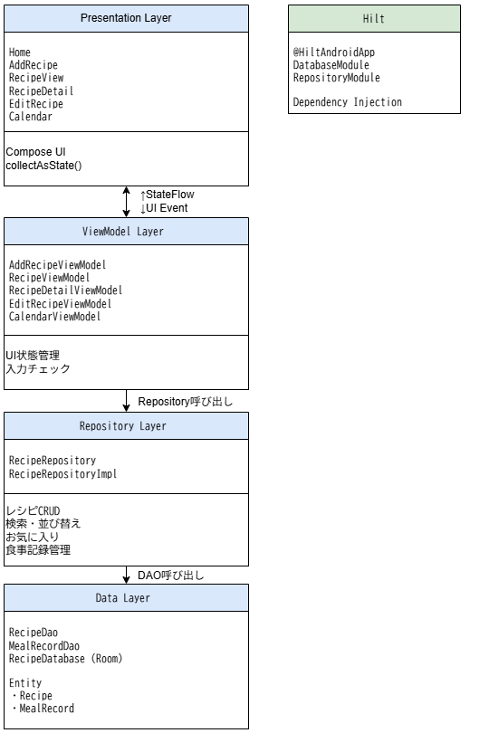

### 画面遷移

ホーム画面を起点として、レシピの追加・一覧・詳細・編集、および食事記録カレンダーへ遷移します。

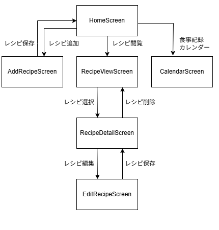

## 今後の改善予定

- 材料を対象とした検索機能
- タグ機能
- UI/UXの改善
- 設定機能(テーマ・壁紙変更)
- クラウド同期